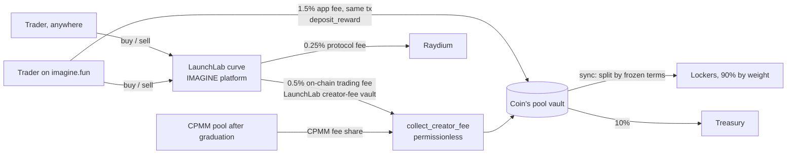

# IMAGINE

**Imagine everyone locks.** Lock-to-earn vaults for coins launched on Raydium
LaunchLab under the IMAGINE platform, paid in each coin's pair asset.

**Lock the meme. Earn its pair.** Every coin is paired with an asset LaunchLab
supports — SOL, USDC, tokenized stocks like NVDAx and SPYx. Every trade of an
IMAGINE coin, anywhere, pays a fee into that coin's pool, and the pool pays the
holders who locked, by how long each of them committed, in the asset the coin is
paired with. A coin paired with NVDAx pays its lockers NVDAx; a SOL-paired coin
pays SOL. The creator earns nothing from fees — they earn only by locking, like
everyone else.

Site: imagine.fun · API: api.imagine.fun · X: [@LockImagine](https://x.com/LockImagine) ·
Program: `imaguT3XXBk1MuKQA6XCk1KJsGM2YgfM1tA4pQQ3spa`

---

## How the money moves



Everything that reaches a pool is in the coin's **quote (pair) asset** and is
paid out in it:

1. **On-chain trading fee, 0.5%.** The IMAGINE LaunchLab platform sets
   LaunchLab's `creator_fee_rate` to its maximum (0.5%) and its platform fee to
   0, and every coin's LaunchLab "creator" is the pool's vault PDA. So 0.5% of
   every curve trade — on Raydium, through Jupiter, any terminal or bot —
   accrues on chain to the coin's pool. After graduation to Raydium CPMM, the
   CPMM pool's fee share goes to the same vault. Anyone can call
   `collect_creator_fee` to pull it into the pool; the keeper does.
2. **App fee, 1.5%** of the quote leg of every trade routed through imagine.fun,
   a `deposit_reward` instruction in the same transaction as the swap
   (`trade_fee_bps = 150`; applied by the API, not enforced by the program).
   **A trade on imagine.fun puts 2% into the pool.**
3. **Donations** — anyone can `deposit_reward`.

The pool detects arrivals by balance difference (`sync`), so every stream above
is credited the same way. Raydium's 0.25% LaunchLab protocol fee is Raydium's.
On graduation the LP is locked; its Fee-Key NFT goes to the treasury.

## Repository

```
programs/imagine/  Anchor program: config, launch (LaunchLab CPI), creator-fee collection, pools, positions, reward accumulator, pricing
packages/sdk/      @imagine/sdk: PDAs, decoders, LaunchLab/CPMM math + builders, quote registry, ImagineClient, math mirror, LiteSVM suites
apps/api/          @imagine/api: Fastify API, transaction builders, read models, indexer + keeper, RPC proxy, Google accounts
apps/web/          @imagine/web: Next.js front-end
video/             Remotion films, X cards and launch package, profile images
docs/              Spec, security review, brand, runbook, launch content
scripts/           Mainnet-fork validator, build/deploy/test wrappers (WSL), image push, renders
tests/fixtures/    Mainnet LaunchLab / CPMM / Token-2022 builds and accounts for LiteSVM
```

## Running it locally

Local development runs against a **mainnet fork**: a local validator with the
real Raydium LaunchLab, CPMM and Token-2022 programs and the quote mints and
LaunchLab GlobalConfigs cloned at their mainnet addresses. The IMAGINE program
is deployed onto it exactly as on mainnet, and the IMAGINE platform is created
on it by the same script.

The Solana toolchain (Anchor, Solana CLI, cargo) and the test runner live in
WSL; the workspace's `node_modules` is the Linux tree (LiteSVM has no Windows
build). Run each line below from the repo root inside WSL
(`wsl -e bash -lc "cd /mnt/c/tech/imagine && …"`).

```bash
bash scripts/wsl-install.sh                     # workspace deps under the Linux node
cp apps/api/.env.example apps/api/.env.local    # every variable is documented there
cp apps/web/.env.example apps/web/.env.local

# 1. Program binary + IDL
bash scripts/anchor-build.sh

# 2. Mainnet fork (RPC on :8999)
(cd apps/api && node scripts/fork-fixtures.ts)  # once, or to refresh the snapshot
bash scripts/mainnet-fork.sh                    # leave running

# 3. IMAGINE platform on LaunchLab, then the program and its config
(cd apps/api && RPC_URL=http://127.0.0.1:8999 CPSWAP_CONFIG=FMmwToGqT9iwDgsqvzLg65vcKSzKme4szbWqX1kyCBCJ \
  node scripts/setup-platform.ts ~/.config/solana/id.json)  # prints the PlatformConfig address
LAUNCHLAB_PLATFORM=<printed address> bash scripts/deploy.sh localnet
bash scripts/config-show.sh                     # prints the on-chain config
(cd apps/api && RPC_URL=http://127.0.0.1:8999 node scripts/create-alt.ts ~/.config/solana/id.json)
#    set the printed LAUNCH_ALT in apps/api/.env.local

# 4. Database (DATABASE_URL in apps/api/.env.local)
createdb imagine

# 5. API, indexer + keeper, web
(cd apps/api && node --env-file=.env.local src/migrate.ts && node --env-file=.env.local src/index.ts)
bash scripts/indexer-local.sh                   # indexer with the keeper, signing with the CLI key
PORT=3010 bash scripts/dev-web.sh               # http://localhost:3010

bash scripts/fund.sh <pubkey> 5                 # airdrop fork SOL to a browser wallet
```

`apps/web/.env.example` points the browser straight at the fork
(`NEXT_PUBLIC_RPC_URL=http://127.0.0.1:8999`); in production it uses the API's
`/rpc` and `/rpc-ws` proxy instead.

## Tests

```bash
bash scripts/verify.sh   # everything below, plus clippy and four typechecks (WSL)
```

| Command | What it proves |
|---|---|
| `cargo test -p imagine --lib` (or `bash scripts/program-test.sh`, which adds clippy) | Reward math: multiplier curve, accumulator conservation, penalty decay, LaunchLab/CPMM price math, and that many uneven deposits can never make a pool owe more than it received |
| `bash scripts/sdk-test.sh` (= `pnpm --filter @imagine/sdk test`) | LiteSVM suites against the real mainnet LaunchLab, CPMM and Token-2022 builds in `tests/fixtures/raydium/`: `imagine.test.ts` (the full instruction surface in the SOL and SPYx paths, every rejection, audit regressions, a randomised churn test asserting solvency after every step), `raydium.test.ts` (launch under the IMAGINE platform → dev buy → found, the one-transaction v0 launch, the 0.5% on-chain trading fee pulled in by `collect_creator_fee` on the curve and after CPMM migration, app fees, migrated-coin pricing), `launchlab.test.ts` (curve/CPMM math and decoders) |
| `pnpm --filter @imagine/api test` | API hardening, no network: `/health` thresholds (indexer lag, keeper below 0.03 / 0.02 SOL, stale or failed runs), the RPC proxy's response cap, the Jupiter instruction allowlist the server signs through, the mint-key proof for replacing stored metadata, bounded dedupe, log-truncation detection |
| `(cd apps/api && node scripts/e2e.ts sol)` / `… spyx` | End to end through the API on the mainnet fork: metadata upload, launch, trade with the app fee, lock, the on-chain trading fee collected and folded in by `sync`, claims in the quote asset, an early exit |

The SDK suites load `target/deploy/imagine-v0.so`, built by
`scripts/anchor-build.sh`. The e2e run needs the fork, the platform and program
set up, and the API running against it.

## What the program will not do

These are properties of the bytecode, not policy:

- **No admin withdraw path.** There is no instruction that moves a pool's quote
  asset or tokens to an admin. Not disabled, not timelocked — absent.
- **Pool terms are frozen at launch.** Fee split, multiplier curve, size tiers,
  penalty, lock bounds, reward stream and treasury address are copied onto the
  pool when it opens. Changing platform defaults only affects later pools.
- **Claims and unlocks cannot be paused.** The pause flag is read only by
  `launch`.
- **The creator locks first.** No one can lock, deposit or extend until the
  creator's founding position exists (`found`, in the launch transaction), so
  every pool has weight from its first live slot.
- **The creator gets nothing from fees.** The pool's split is 90% lockers, 10%
  treasury (which funds continued development and future updates), 0% creator,
  and the coin's LaunchLab "creator" is the pool vault. Creators who want a share
  lock their own tokens and earn like any other locker.
- **Coins only launch under the configured platform.** `launch` creates the coin
  through LaunchLab under `config.launchlab_platform` and makes the pool's vault
  the LaunchLab pool creator.
- **Hostile mints are rejected.** The coin must be exactly the Token-2022 shape
  LaunchLab creates (no freeze authority, no transfer fee, no hook, no permanent
  delegate). A quote mint with a transfer fee, an active transfer-hook program,
  frozen-by-default accounts or non-transferability cannot back a pool.

## Reward math

All reward amounts are in **quote base units** (lamports for SOL, the mint's
base units for USDC or an xStock).

```
weight          = amount × multiplier
multiplier      = (1.0 + (max − 1.0) × √((term − min) / (max_term − min))) × (1 + size_bonus)
acc            += released_quote × SCALE / total_weight          SCALE = 1e12
claimable       = (weight × acc − reward_debt) / SCALE
reward_cap      = quote value of the tokens when locked × multiplier
paid            ≤ reward_cap − claimed; the excess, and any inflow open locks cannot use → treasury
```

The quote value is read on chain from where the coin trades: the LaunchLab
curve's virtual + real reserves while it is live, the canonical Raydium CPMM
pool's vaults once it has migrated.

`reward_debt` is carried in scaled units so each position keeps its sub-unit
residue. The pool rounds its committed amount *up* from the credit it hands out
and every claim rounds *down*, so the sum of claims never exceeds it.

## Deployment

Railway project `imagine`, GitHub-linked to `main` (auto-deploy on push); both
apps build from their Dockerfiles with the repository root as context.
`scripts/push-api.sh` / `scripts/push-web.sh` build and push the same images to
GHCR when a local build is needed.

| Service | Dockerfile | Needs |
|---|---|---|
| `imagine-api` (`ROLE=index`, HTTP) and `imagine-indexer` (`ROLE=indexer`, keeper) | `apps/api/Dockerfile` | `DATABASE_URL`, `RPC_URL`, `RPC_WS_URL`, `RPC_PROXY_LIMIT_PER_MIN`, `CLUSTER`, `CORS_ORIGINS`, `SITE_ORIGIN`, `API_PUBLIC_ORIGIN`, `COOKIE_SECURE`, `LAUNCH_ALT`, `IMAGINE_INTERNAL_KEY`, `GOOGLE_CLIENT_ID`, `GOOGLE_CLIENT_SECRET`, `GOOGLE_REDIRECT_URI`, `WALLET_MASTER_KEY`, `SESSION_SECRET`; indexer: `KEEPER_KEYPAIR`, `KEEPER_INTERVAL_MS`, `SYNC_MIN_USD` |
| `imagine-web` | `apps/web/Dockerfile` | Build args `NEXT_PUBLIC_API_URL`, `NEXT_PUBLIC_RPC_URL` (`https://api.imagine.fun/rpc`), `NEXT_PUBLIC_WS_URL` (`wss://api.imagine.fun/rpc-ws`), `NEXT_PUBLIC_CLUSTER`, `NEXT_PUBLIC_GOOGLE_CLIENT_ID`, `NEXT_PUBLIC_X_URL`; runtime `IMAGINE_INTERNAL_KEY` |

See `docs/RUNBOOK.md` for the platform setup, the program upgrade, DNS, OAuth
and the mainnet checklist; `docs/SPEC.md` for the mechanism; `docs/AUDIT.md`
for the security review; `docs/BRAND.md` for the brand system.
