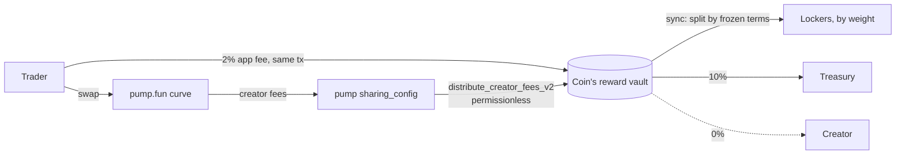

# VISE

**Hold under pressure.** Time-weighted lock-to-earn vaults for pump.fun coins.

Every trade on a VISE coin pays a fee. That fee goes to the people still holding
it, split by how long each of them committed. Lock for a week and your bag counts
once; lock for a year and the same bag counts four times.

Program: `VisecyrWrgtRg9wYhXe9ZgJ4tJBD9dPLCHoqXc54FRb`

---

## How the money moves



Two streams, both SOL, both landing in one vault per coin:

1. **App fee** — 2% of the SOL leg on trades routed through the VISE front-end,
   attached as an instruction in the same transaction as the swap.
2. **pump.fun creator fees** — routed to the vault at launch via pump's own
   fee-sharing program. `update_fee_shares_v2` revokes its own admin, so the
   routing is permanent and nobody can redirect it afterwards.

The pool detects arrivals by balance difference, so donations and any future
stream work without a code change.

## Repository

```
programs/vise/     Anchor program: config, pools, positions, reward accumulator
packages/sdk/      TypeScript SDK: PDAs, decoders, instruction builders, math mirror
apps/api/          Fastify API: transaction builders, read models, indexer
apps/web/          Next.js front-end
video/             Remotion project for the promo renders
docs/              Spec, brand, security notes, launch content
scripts/           Local validator with real pump programs, devnet helpers
```

## Running it locally

The local rig clones the **real** pump.fun programs from devnet into a local
validator, so a launch exercises the same code path mainnet would.

```bash
pnpm install

# 1. Validator with pump.fun cloned in, plus the VISE program and its
#    fee-collecting accounts pre-created
bash scripts/localnet-up.sh

# 2. Database
createdb vise   # or use the DATABASE_URL in apps/api/.env.local
node --env-file=apps/api/.env.local apps/api/src/migrate.ts

# 3. API + indexer + web
pnpm --filter @vise/api start
pnpm --filter @vise/api indexer
pnpm --filter @vise/web dev
```

## Tests

```bash
bash scripts/verify.sh   # everything below, plus clippy and four typechecks
```

| Command | What it proves |
|---|---|
| `cargo test -p vise --lib` | Reward math: multiplier curve, accumulator conservation, penalty decay, and that many uneven deposits can never make a pool owe more than it received |
| `node --test packages/sdk/test/vise.test.ts` | 26 integration tests on LiteSVM: the full instruction surface, every rejection path, and a randomised churn test asserting solvency after every step |
| `node apps/api/scripts/e2e.ts` | End-to-end against the real pump.fun program: launch, fee routing, pool, trade with fee, weighted accrual, claims, solvency |

The integration and e2e suites need the local validator running.

The end-to-end script pre-creates pump.fun's fee-collecting accounts before each
trade. pump rotates which one it credits by slot, and on a fresh local ledger a
fee smaller than the rent-exempt minimum would leave a brand-new destination
rent-paying — the runtime then rejects the whole transaction. On devnet and
mainnet those accounts already exist, so this is a fixture concern only.

## What the program will not do

These are properties of the bytecode, not policy:

- **No admin withdraw path.** There is no instruction that moves a pool's SOL or
  tokens to an admin. Not disabled, not timelocked — absent.
- **Pool terms are frozen at creation.** Fee split, multiplier curve, penalty,
  lock bounds, and treasury address are copied onto the pool when it opens.
  Changing platform defaults later only affects pools created later.
- **Claims and unlocks cannot be paused.** The pause flag is read only by
  `create_pool`.
- **The creator locks first.** A pool cannot exist without the creator's founding
  position, created in the same instruction, so every pool has non-zero weight
  from its first slot and no one can scoop an unassigned remainder.
- **Hostile mints are rejected.** Freeze authority, transfer fees, transfer
  hooks, permanent delegates and non-transferable mints are refused at pool
  creation; each lets a third party strand locked principal.

## Reward math

```
weight          = amount × multiplier
multiplier      = 1.0 + (max − 1.0) × (term − min) / (max_term − min)
acc            += committed_lamports × SCALE / total_weight
claimable       = (weight × acc − reward_debt) / SCALE
```

`reward_debt` is carried in scaled units so each position keeps its sub-lamport
residue. That is what makes the pool solvent: rounding to whole lamports on every
claim would let positions round up independently until the pool owed more than it
held. `distribute` rounds the pool's committed amount *up* from the credit it
handed out, so the sum of every floored claim can never exceed it.

## Deployment

Both apps ship as Dockerfiles with the repository root as build context.

| Service | Image | Needs |
|---|---|---|
| `vise-api` | `apps/api/Dockerfile` | `DATABASE_URL`, `RPC_URL`, `TREASURY_PUBKEY`, `TRADE_FEE_BPS` |
| `vise-web` | `apps/web/Dockerfile` | `NEXT_PUBLIC_API_URL`, `NEXT_PUBLIC_RPC_URL` (build args) |

See `docs/RUNBOOK.md` for the program deployment and the mainnet checklist.
