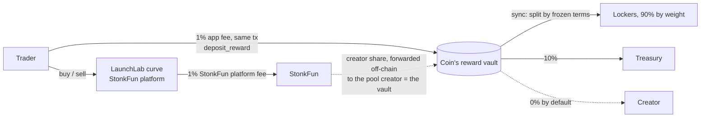

# IMAGINE

**Imagine everyone locks.** Lock-to-earn vaults for coins launched on
[StonkFun](https://www.stonkfun.xyz), paid in each coin's pair asset.

**Lock the meme. Earn its pair.** Every StonkFun coin is paired with an asset —
a tokenized stock like NVDAx or SPYx, a stablecoin, or SOL. Every trade on an
IMAGINE coin pays a fee into that coin's pool, and the pool pays the holders who
locked, by how long each of them committed, in the asset the coin is paired
with. A coin paired with NVDAx pays its lockers NVDAx; a SOL-paired coin pays SOL.

Site: imagine.fun · API: api.imagine.fun ·
Program: `imaguT3XXBk1MuKQA6XCk1KJsGM2YgfM1tA4pQQ3spa`

---

## How the money moves



Everything that reaches a vault is in the coin's **quote (pair) asset** and is
paid out in it:

1. **App fee** — 1% of the quote leg of every trade routed through imagine.fun,
   a `deposit_reward` instruction in the same transaction as the swap. The rate
   is the config's `trade_fee_bps = 100`; the API applies it, the program does
   not enforce it.
2. **StonkFun creator share** — StonkFun charges 1% on curve trades and forwards
   a creator share to the LaunchLab pool's `creator`. For an IMAGINE coin that
   creator *is* the pool's reward vault PDA, so forwarded shares land in the
   vault (native SOL for SOL-paired coins, the vault's token account otherwise).
   Forwarding is StonkFun's off-chain policy; the program counts what arrives
   and promises nothing about how much.
3. **Donations** — anyone can `deposit_reward`.

The pool detects arrivals by balance difference (`sync`), so every stream above
is credited the same way. Raydium LaunchLab's protocol fee applies to curve
trades as well; it goes to Raydium, not to the pool.

## Repository

```
programs/imagine/  Anchor program: config, launch (LaunchLab CPI), pools, positions, reward accumulator, pricing
packages/sdk/      @imagine/sdk: PDAs, decoders, LaunchLab/CPMM math + builders, ImagineClient, math mirror, LiteSVM suites
apps/api/          @imagine/api: Fastify API, transaction builders, read models, indexer + keeper, Google accounts
apps/web/          @imagine/web: Next.js front-end
video/             Remotion films, X cards, profile images
docs/              Spec, security review, brand, runbook, launch content
scripts/           Mainnet-fork validator, build/deploy/test wrappers (WSL), image push, renders
tests/fixtures/    Mainnet LaunchLab / CPMM / Token-2022 builds and StonkFun accounts for LiteSVM
```

## Running it locally

StonkFun exists on mainnet only, so local development runs against a
**mainnet fork**: a local validator with the real Raydium LaunchLab, CPMM and
Token-2022 programs and StonkFun's platform accounts cloned at their mainnet
addresses. The IMAGINE program is deployed onto it exactly as on mainnet.

The Solana toolchain (Anchor, Solana CLI, cargo) and the test runner live in
WSL; the workspace's `node_modules` is the Linux tree (LiteSVM has no Windows
build). Run each line below from the repo root inside WSL
(`wsl -e bash -lc "cd /mnt/c/tech/imagine && …"`).

```bash
bash scripts/wsl-install.sh                     # workspace deps under the Linux node
cp apps/api/.env.example apps/api/.env.local    # every variable is documented there
cp apps/web/.env.example apps/web/.env.local

# 1. Program binary + IDL
bash scripts/anchor-build.sh

# 2. Mainnet fork (RPC on :8999)
(cd apps/api && node scripts/fork-fixtures.ts)  # once, or to refresh the snapshot
bash scripts/mainnet-fork.sh                    # leave running

# 3. Deploy IMAGINE onto the fork and initialise its config
bash scripts/deploy.sh localnet
bash scripts/config-show.sh                     # prints the on-chain config
(cd apps/api && LAUNCH_ALT= RPC_URL=http://127.0.0.1:8999 node scripts/create-alt.ts ~/.config/solana/id.json)
#    set the printed address as LAUNCH_ALT in apps/api/.env.local

# 4. Database (DATABASE_URL in apps/api/.env.local)
createdb imagine

# 5. API, indexer + keeper, web
(cd apps/api && node --env-file=.env.local src/migrate.ts && node --env-file=.env.local src/index.ts)
bash scripts/indexer-local.sh                   # indexer with the keeper, signing with the CLI key
PORT=3010 bash scripts/dev-web.sh               # http://localhost:3010

bash scripts/fund.sh <pubkey> 5                 # airdrop fork SOL to a browser wallet
```

`apps/web/.env.example` points the browser straight at the fork
(`NEXT_PUBLIC_RPC_URL=http://127.0.0.1:8999`); in production it uses the
API's `/rpc` and `/rpc-ws` proxy instead.

## Tests

```bash
bash scripts/verify.sh   # everything below, plus clippy and four typechecks (WSL)
```

| Command | What it proves |
|---|---|
| `cargo test -p imagine --lib` (or `bash scripts/program-test.sh`, which adds clippy) | Reward math: multiplier curve, accumulator conservation, penalty decay, LaunchLab/CPMM price math, and that many uneven deposits can never make a pool owe more than it received |
| `bash scripts/sdk-test.sh` (= `pnpm --filter @imagine/sdk test`) | LiteSVM suites against the real mainnet LaunchLab, CPMM and Token-2022 builds in `tests/fixtures/raydium/`: `imagine.test.ts` (the full instruction surface in both the SOL and SPYx paths, every rejection, audit regressions, a randomised churn test asserting solvency after every step), `stonkfun.test.ts` (StonkFun launch → dev buy → found, the one-transaction v0 launch, forwarded creator share picked up by `sync`, app fees, migrated-coin pricing), `launchlab.test.ts` (curve/CPMM math and decoders) |
| `(cd apps/api && node scripts/e2e.ts sol)` / `… spyx` | End to end through the API on the mainnet fork: metadata upload, launch on StonkFun, trade with the app fee, lock, a simulated StonkFun forward folded in by `sync`, claims in the quote asset, an early exit |

The SDK suites load `target/deploy/imagine-v0.so`, built by
`scripts/anchor-build.sh`. The e2e run needs the fork, the program deployed
with its config initialised, and the API running against it.

## What the program will not do

These are properties of the bytecode, not policy:

- **No admin withdraw path.** There is no instruction that moves a pool's quote
  asset or tokens to an admin. Not disabled, not timelocked — absent.
- **Pool terms are frozen at launch.** Fee split, multiplier curve, size tiers,
  penalty, lock bounds, reward stream and treasury address are copied onto the
  pool when it opens. Changing platform defaults only affects later pools.
- **Claims and unlocks cannot be paused.** The pause flag is read only by
  `launch`.
- **The creator locks first.** No one can lock, deposit or extend until the
  creator's founding position exists (`found`, in the launch transaction), so
  every pool has weight from its first live slot and no one can scoop an
  unassigned remainder.
- **Coins only launch under StonkFun.** `launch` creates the coin through
  LaunchLab under the configured platform (StonkFun's PlatformConfig) and makes
  the pool's vault the LaunchLab pool creator.
- **Hostile mints are rejected.** The coin must be exactly the Token-2022 shape
  LaunchLab creates (no freeze authority, no transfer fee, no hook, no permanent
  delegate). A quote mint with a transfer fee, an active transfer-hook program,
  frozen-by-default accounts or non-transferability cannot back a pool.

## Reward math

All reward amounts are in **quote base units** (lamports for SOL, the mint's
base units for USDC or an xStock).

```
weight          = amount × multiplier
multiplier      = (1.0 + (max − 1.0) × √((term − min) / (max_term − min))) × (1 + size_bonus)
acc            += released_quote × SCALE / total_weight          SCALE = 1e12
claimable       = (weight × acc − reward_debt) / SCALE
reward_cap      = quote value of the tokens when locked × multiplier
paid            ≤ reward_cap − claimed; the excess, and any inflow open locks cannot use → treasury
```

The quote value is read on chain from where the coin trades: the LaunchLab
curve's virtual + real reserves while it is live, the canonical Raydium CPMM
pool's vaults once it has migrated.

`reward_debt` is carried in scaled units so each position keeps its sub-unit
residue. That is what keeps the pool solvent: rounding to whole base units on
every claim would let positions round up independently until the pool owed more
than it held. The pool rounds its committed amount *up* from the credit it hands
out and every claim rounds *down*, so the sum of claims never exceeds it.

## Deployment

Both apps ship as Dockerfiles with the repository root as build context; images
are built locally and pushed (`scripts/push-api.sh`, `scripts/push-web.sh`).

| Service | Image | Needs |
|---|---|---|
| `imagine-api` (`ROLE=index`, HTTP) and its indexer (`ROLE=indexer`) | `apps/api/Dockerfile` → `ghcr.io/realdoomsman/imagine-api` | `DATABASE_URL`, `RPC_URL`, `RPC_WS_URL`, `RPC_PROXY_LIMIT_PER_MIN`, `CLUSTER`, `CORS_ORIGINS`, `SITE_ORIGIN`, `API_PUBLIC_ORIGIN`, `COOKIE_SECURE`, `LAUNCH_ALT`, `IMAGINE_INTERNAL_KEY`, `GOOGLE_CLIENT_ID`, `GOOGLE_CLIENT_SECRET`, `GOOGLE_REDIRECT_URI`, `WALLET_MASTER_KEY`, `SESSION_SECRET`; indexer: `KEEPER_KEYPAIR`, `KEEPER_INTERVAL_MS`, `SYNC_MIN_USD` |
| `imagine-web` | `apps/web/Dockerfile` → `ghcr.io/realdoomsman/imagine-web` | Build args `NEXT_PUBLIC_API_URL`, `NEXT_PUBLIC_RPC_URL` (`https://api.imagine.fun/rpc`), `NEXT_PUBLIC_WS_URL` (`wss://api.imagine.fun/rpc-ws`), `NEXT_PUBLIC_CLUSTER`, `NEXT_PUBLIC_GOOGLE_CLIENT_ID`, `NEXT_PUBLIC_OFFICIAL_MINT`, `NEXT_PUBLIC_X_URL`; runtime `IMAGINE_INTERNAL_KEY` |

See `docs/RUNBOOK.md` for the program deployment, DNS, OAuth and the mainnet
checklist; `docs/SPEC.md` for the mechanism; `docs/AUDIT.md` for the security
review; `docs/BRAND.md` for the brand system.
